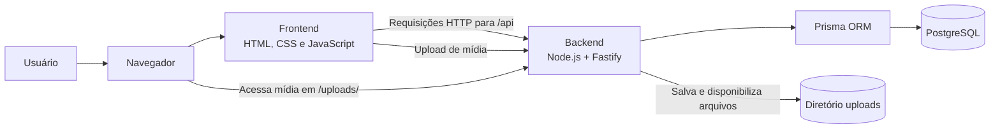
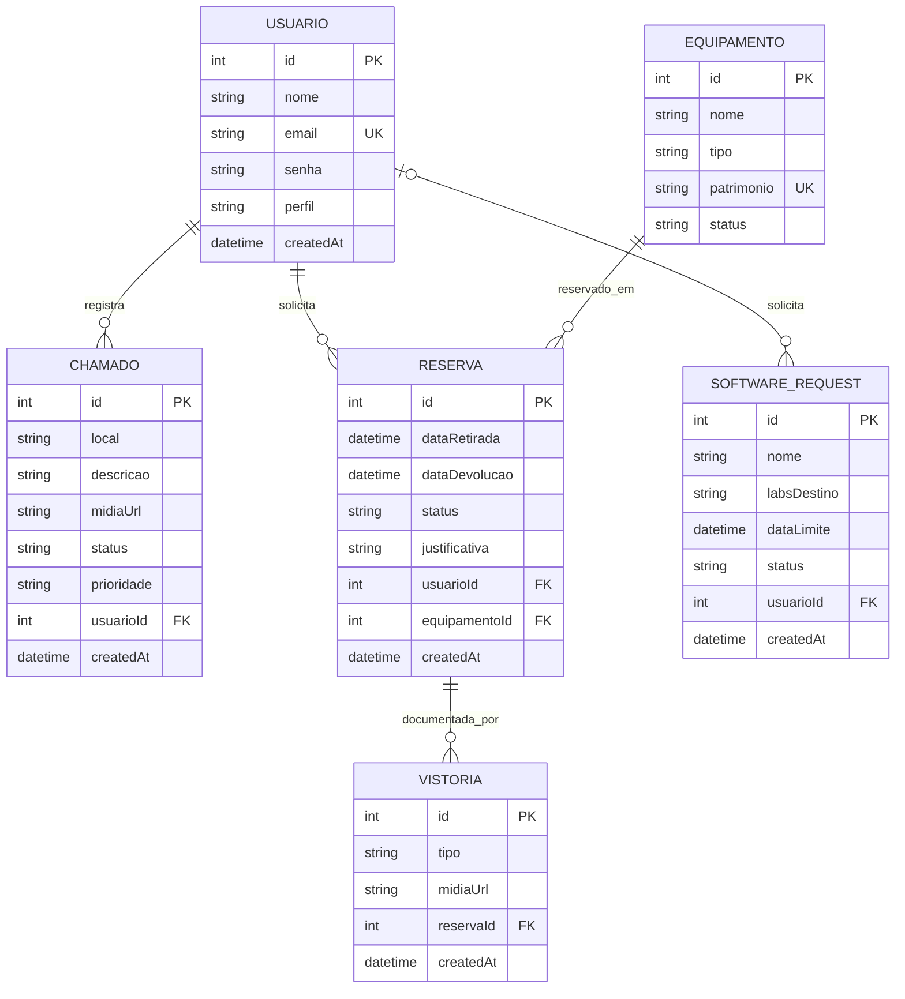
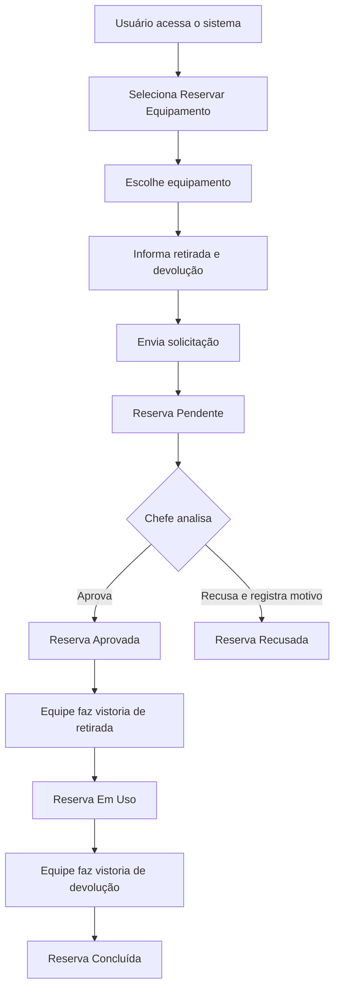
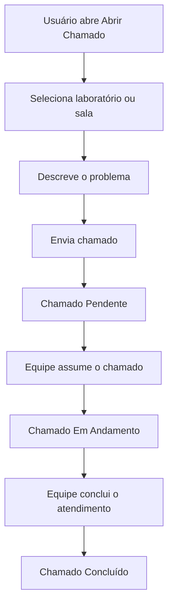
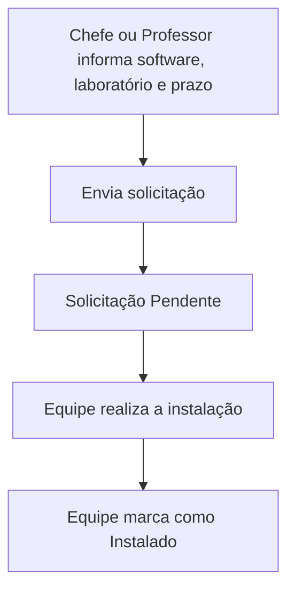

# Diagramas do Sistema Lab UTFPR

Este documento reúne diagramas de arquitetura, dados e fluxos de uso do sistema. Os diagramas são escritos em Mermaid e podem ser visualizados em visualizadores compatíveis.

## Arquitetura

## Modelo de dados

## Fluxo de reserva de equipamento

> **Observação:** o código atual da interface exibe o envio da vistoria como simulação. O fluxo de vistoria acima descreve a sequência pretendida, não confirma que o envio esteja efetivamente persistido pela interface.

## Fluxo de chamado técnico

## Fluxo de solicitação de software

